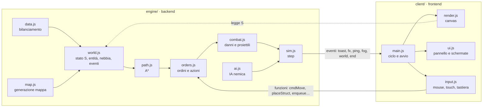

# Architettura

Il gioco è diviso in due parti che si parlano attraverso un contratto stretto.

## Motore (`engine/`)

Codice JavaScript puro (moduli ES), senza DOM: gira nel browser e in Node. Si importa solo da `engine/index.js`.

| File | Contenuto |
|---|---|
| `data.js` | costanti della mappa; telai, propulsioni, armi ed edifici con livello tecnologico (`tier` 1–4) e famiglia d'arma; ricerche con requisiti ed effetti (`eff`); livelli di difficoltà |
| `util.js` | numeri casuali con seme, rumore per il terreno, angoli, riferimenti di settore (A1–H8) |
| `map.js` | mappa 64×64 simmetrica rispetto al centro, giacimenti, corridoi garantiti tra le basi |
| `world.js` | stato `S`, creazione di mezzi ed edifici, visibilità del giocatore, salvataggio, eventi |
| `path.js` | passabilità e percorsi A* a 8 direzioni, disposizione dei gruppi, mappe di raggiungibilità (`reachMap`, `reachableAdj`) |
| `orders.js` | ordini (muovi, attacca, costruisci, ferma), piazzamento, produzione, ricerca, smontaggio (`demolish`) |
| `combat.js` | distanze, scelta dei bersagli, danno con corazza e modificatori dell'arma (`hitDamage`, `areaDamage`), colpi, proiettili (`tracer`, `shell`, `rocket`, `missile`, `mortar`), fiamma e riparazione |
| `sim.js` | movimento, costruzione, produzione, torrette, officine, fine partita, `step(dt)` |
| `mission.js` | preparazione delle missioni della campagna, obiettivi (`S.objective`), ondate dai bordi, fine missione |
| `campaign.js` | funzioni pure della campagna: `newCampaign`, `startMission`, `finishMission`, `campaignSummary`, `normalizeCampaign` |
| `ai.js` | IA (per entrambi i lati, `aiTick(owner)`; il giocatore solo in autoplay per le simulazioni). Per il Direttorio Ferreo: pompe, edifici, ricerca, produzione, difesa, ondate; sceglie solo posti raggiungibili e smonta i cantieri bloccati da più di `AI_STALL` secondi |

### Livelli tecnologici e ricerche

Ogni parte, edificio e ricerca ha un livello da I a IV. Le parti di livello I sono libere; le altre richiedono la loro
ricerca. Per avviare una ricerca di livello N+1 servono `TIER_GATE` (2) ricerche completate di livello N, oltre ai
requisiti in `req`. `techBlockReason(owner, id)` restituisce il motivo in italiano o `null`; `tierAvail` e `tierDone`
servono al pannello. Gli effetti dei potenziamenti si calcolano al momento dell'uso (`armorBonus`, `dmgMul`,
`speedMul`, `towerWeapon`), quindi valgono anche per i mezzi già in campo, le torrette e i bunker.

Armi con regole speciali: lanciafiamme (`armorK` dimezza la corazza, `vsStruct` più danno agli edifici, area), modulo
riparazione (`heal`: cura il mezzo alleato più danneggiato entro 3 caselle, non attacca), missile anticarro
(`antiArmor`: +10% di danno per punto di corazza), lanciarazzi (`salvo`: razzi per salva), obice e mortaio
(`minRange`, area). Limite di mezzi per lato: `UNIT_CAP` = 100.

### Stato

`S` è un oggetto serializzabile in JSON: `seed`, `diff`, `time`, `ents` (mezzi ed edifici, con `id`), `res`
(gasolio per lato), `tech` (ricerche completate per lato), `designs` (progetti del giocatore), `ai`, `stats`,
`timers`, `phase` (`play`, `won`, `lost`). Terreno, giacimenti e occupazione si ricalcolano dal seme.
`S.ai.skip` elenca i giacimenti che l'IA ha scartato perché irraggiungibili; i campi numerici `aiA`…`aiT` sugli
edifici incompiuti dell'IA servono a riconoscere i cantieri fermi. Il salvataggio (`serialize`) include anche i
proiettili in volo, che `loadState` rimette nell'array `proj`.

### Eventi verso il client

| Evento | Dati | Uso |
|---|---|---|
| `world` | — | nuova mappa: il client ridisegna il terreno |
| `fog` | — | visibilità aggiornata (ogni 0,2 s) |
| `fx` | `{k, …}` con `k` tra `boom`, `scorch`, `flash`, `tracer`, `hit`, `trail`, `spark`, `spray`, `chimney`, `flame` (`{x1,y1,x2,y2,r,owner}`), `repair` (`{x1,y1,x2,y2,owner}`); `flash` porta `w` (chiave dell'arma in `WEAPONS`) e `owner` (chi spara); `boom` porta `kind` (`unit`, `struct`: `owner` è il lato distrutto; `shot`: `owner` è il tiratore) | effetti visivi e suoni |
| `unit` | `{owner, id, x, y}` | un mezzo (anche un geniere) esce da fabbrica o comando |
| `built` | `{owner, id, type}` | un cantiere è finito (non per il comando iniziale) |
| `placed` | `{owner, id, type}` | un cantiere è stato piazzato |
| `research` | `{owner, id}` | una ricerca è completata |
| `toast` | `{text, kind}` | avviso al giocatore (`kind`: vuoto, `warn`, `bad`) |
| `ping` | `{x, y}` | segnale sulla minimappa |
| `end` | `{won, reason}` (`objective`, `destroyed`, `time`) | fine partita o missione |
| `objective` | `{type, progress, target, text, done}` | avanzamento dell'obiettivo di missione (al massimo 2 al secondo) |

## Client (`client/`)

| File | Contenuto |
|---|---|
| `index.html` | struttura della pagina (barra, mappa, pannello, copertina) |
| `style.css` | stile e token di colore |
| `state.js` | stato del solo client: selezione, camera, scheda attiva, effetti |
| `render.js` | coordina il fotogramma: visuale, ordine degli strati, nebbia, minimappa, scossa dello schermo (spegnibile, spenta con «riduci movimento» e in «minima») |
| `look.js` | costanti dell'aspetto (palette dei materiali, luce, colori dei lati) |
| `terrain.js` | tela unica della mappa cotta a pezzi di 8×8 caselle: avvia il worker del terreno da un Blob e, se mancano Worker o OffscreenCanvas, cuoce sul filo principale un pezzo per fotogramma |
| `terrain-bake.js` | cottura del terreno «A+» (materiali sfumati, rilievo illuminato, erba, rive, massi, sterrati, alberi e, per le mappe disegnate, città e strade), comune a worker e filo principale |
| `terrain-worker.js` | Web Worker del terreno; `scripts/build.mjs` lo impacchetta a parte e lo mette nel gioco come testo (`__TERRAIN_WORKER__`) |
| `decals.js` | segni che restano: crateri e bruciature timbrati sul terreno (tetto 220), impronte dei cingoli su una tela a metà risoluzione che sbiadisce |
| `vehicles.js` | sagome dei mezzi cotte per direzione (cupola, portelli, cingoli a maglie, insegne, filo di luce, ombra), beccheggio, torretta verso il bersaglio, scarico, bossoli, relitti in fiamme |
| `structs.js` | edifici: tetti in lamiera e cemento, camino che fuma, luci di segnalazione, ombra |
| `atmos.js` | acqua animata (increspature, riflesso, cerchi e schizzi), ombre delle nuvole, alberi che ondeggiano e si piegano all'onda d'urto, correzione colore |
| `light.js` | aloni additivi di esplosioni e incendi; di notte (`S.night`) tela della luce a 1/4 con fari, lampade, finestre e contorno del colore del lato sui mezzi |
| `effects.js` | effetti: esplosioni a fasi (lampo, palla di fuoco, onda d'urto, detriti, fungo, cratere), scintille, torretta sbalzata, crollo degli edifici a fasi |
| `input.js` | selezione, ordini, scorciatoie; su touch un dito scorre la mappa con inerzia, due dita zoomano, tocco con aggancio, doppio tocco, tocco lungo con riquadro; squadre 1–4 condivise con Ctrl+1–9 |
| `ui.js` | pannello (Costruisci, Produzione, Ricerca, Progetta), avvisi, barra |
| `screens.js` | menu principale (Campagna, Schermaglia), elenco missioni, briefing, indicatore dell'obiettivo, rapporti di fine missione e di schermaglia, schermata finale, conferma d'uscita |
| `campaign.js` | salvataggio della campagna sul dispositivo (`localStorage`, chiave `wz.campagna`) |
| `audio.js` | suoni sintetizzati con Web Audio, posizionati rispetto alla visuale, con limite di voci; volume e acceso/spento salvati sul dispositivo |
| `music.js` | colonna sonora originale generata in tempo reale: strati calma, tensione e battaglia sullo stesso orologio e sulla stessa armonia, con dissolvenze guidate dall'intensità dei combattimenti; temi del menu, vittoria, sconfitta e cambio di fase; un profilo per ogni missione della campagna (`musicMission(id, fase)`: tonalità, tempo, variante del tema, strumenti), frase «Valle liberata» alla fine della campagna; scala di epicità 1–8 per missione (`epic`, strati che si sommano gradino per gradino), motivo della Brigata (`BRIGATA`) che si completa lungo la campagna e culmine a orchestra piena dal gradino 6 negli scontri più intensi, entro un limite di voci (`MUSIC_LIMITS`); volume e acceso/spento salvati sul dispositivo |
| `urban.js` | disegno di città (isolati a corte, tetti, poderi), strade con raccordi e mezzeria, ponti, nomi dei luoghi delle mappe disegnate |
| `weather.js` | meteo, solo aspetto: pioggia (terreno lucido, pozzanghere, gocce, schizzi, lampo e tuono) e nebbia (velo e banchi), con passaggio graduale al cambio; segue i livelli di qualità e «riduci movimento» |
| `livery.js` | livree dei veterani sempre più vistose per grado (Esperto, Veterano, Asso), dipinte sopra la sagoma di serie per ogni progetto, nello stile di ciascun lato |
| `veterans.js` | nomi dei gradi, soprannomi degli assi del giocatore (solo client), lampo e suono della promozione (evento `rank`), pulsante e conto alla rovescia della Macchina di Villo (evento `hero`) |
| `hero.js` | la Macchina di Villo (solo campagna): berlina grigia disegnata da zero, livree per grado, bagagliaio con l'impianto stereo e colpi «Bassi a palla» (onde sonore ed esplosione speciale, colpo grosso con lampo) |
| `dims.js` | ingombro disegnato dei mezzi (genieri, Macchina di Villo, telai) per scarichi, fari, relitti, impronte e neon |
| `latina.js` | testi con un sorriso nella sola schermaglia su Latina: rapporto finale (uno di tre a caso per partita), battute brevi in partita nate da eventi esistenti (strade, ponti, mezzi distrutti in città, prima pompa, prima fabbrica nemica), al massimo una ogni 90 s e una volta ciascuna; nota sulle buche nel menu |
| `prefs.js` | scelte ricordate sul dispositivo: mappa della schermaglia (`wz.mappa`), nomi dei luoghi (`wz.luoghi`) e scossa dello schermo (`wz.scossa`) |
| `anim.js` | animazioni del client: assetto e rinculo dei mezzi, porte delle fabbriche, cantiere con gru, palla di fuoco, macerie degli edifici; rispetta qualità adattiva e «riduci movimento» |
| `alerts.js` | posizione degli avvisi toccabili, pulsante «Allarme» (ultimi scontri), frecce ai bordi per gli scontri fuori visuale |
| `quality.js` | qualità degli effetti a quattro livelli (alta, media, bassa, minima) e «auto» adattiva: misura il tempo per fotogramma e regola particelle, animazioni, luce e risoluzione della tela; con più di 120 mezzi «auto» parte da «bassa» e può scendere a «minima», che costa quanto la «bassa» di prima; scelta «Effetti» salvata sul dispositivo |
| `main.js` | collega eventi e moduli, ciclo di gioco, aggancio di test `window.__wz` (anche `fxq()` e `setFx()` per la qualità, `gfx()` per come si cuoce il terreno e se la visuale è pronta) |

## Mappe disegnate

`engine/maps/` contiene le mappe disegnate a mano per la schermaglia: ogni mappa è un testo di 64 righe (una lettera
per terreno, legenda nel file), con le basi dei due lati, i giacimenti e i luoghi principali. `MAPS` elenca le mappe
per il menu (`casuale`, `latina`); `newGame(diff, seed, { map: 'latina' })` avvia la schermaglia su una mappa disegnata
e `S.map` la ricorda nel salvataggio. Due terreni valgono solo qui: `CITY` (isolato, non si attraversa né si
costruisce) e `ROAD` (strada: si costruisce e i mezzi vanno più veloci secondo `PROPS[p].road`; A* preferisce le
strade). `homeOf(o)` dà il centro della base di partenza di un lato. `S.night` è vero nelle missioni notturne
(campo `night` di `MISSIONS`, oggi solo la 1) e serve solo alla grafica.

## Meteo, gradi e Macchina di Villo

- **Meteo** (`WEATHER` in `engine/data.js`): `clear`, `rain`, `fog`. Pioggia: fuori strada ruote ×0,8 e semicingoli
  ×0,9, lanciafiamme ×0,75. Nebbia: vista ×0,7 (minimo `SIGHT.min`), si spara solo a ciò che il proprio lato vede.
  `S.weather` è il tempo attuale, `S.weatherMode` la scelta della schermaglia (`newGame(diff, seed, { weather })`,
  anche `variable`: cambia ogni `WEATHER_VAR` secondi, deterministico dal seme). Le missioni hanno il campo `weather`;
  in «Contrattacco» la pioggia smette alla fase 2. Evento `weather` `{ from, to }` con avviso.
- **Gradi** (`RANKS`, `RANK_XP`, `RANK_CALM`): ogni mezzo ha `xp` e `rank` (0–3). Esperienza al colpo di grazia
  (anche per il nemico) e alle riparazioni; ogni grado moltiplica danno e punti struttura, l'asso si ripara da solo
  dopo `RANK_CALM` secondi senza combattere. Genieri ed edifici esclusi. Evento `rank`.
- **Veterani in campagna** (`VETERANS_MAX`, `VETERANS_RANK`): alla vittoria fino a 3 mezzi dal grado Veterano in su
  passano alla missione dopo (campo `veterans` dello stato della campagna).
- **Macchina di Villo** (`HERO`, `HERO_W`): mezzo speciale in tutte le missioni della campagna, mai in schermaglia né
  producibile; livello di forza per missione (`HERO.levels`); arma «Bassi a palla» con un colpo grosso ogni terzo
  (`fx` con `hero` e `big`). Distrutta, non fa perdere: torna dopo `HERO.respawn` secondi accanto al comando con grado
  ed esperienza (`S.hero`, evento `hero`; grado ed esperienza passano da una missione all'altra nel campo `hero`).

## Campagna

`MISSIONS` in `engine/data.js` descrive le 8 missioni (briefing, obiettivo, livello massimo, seme e ritocchi della
mappa, configurazione del giocatore e del nemico). `newGame(diff, seed, opts)` con `opts.mission`, `opts.tech` e
`opts.designs` prepara una missione; senza `opts` è la schermaglia. Il client tiene lo stato della campagna (missioni
vinte, ricerche e progetti accumulati, migliori tempi) e lo aggiorna con `finishMission` dopo ogni vittoria.
`tests/balance/campagna.mjs` gioca la campagna con l'IA dalla parte del giocatore (`S.autoplay`) per il bilanciamento.
Le difficoltà in missione seguono `MISSION_DIFF` (scala di `DIFF` attenuata; la schermaglia usa `DIFF` pieno).
Campi di missione per il nemico oltre a rendita e ondate: `factories` (0 = niente fabbriche), `keep` (quota di
difensori che resta in base). L'IA del giocatore in autoplay usa `AI_TECH_P` e `AI_PLAYER`. Risultati e scelte del
bilanciamento in [`bilanciamento.md`](bilanciamento.md).

## Build

`npm run build` (esbuild) produce un solo file con CSS e JavaScript in linea:

- `dist/index.html`: documento completo, per browser e per l'app Android;
- `dist/artifact.html`: frammento per l'anteprima pubblicata su claude.ai.

Il worker del terreno (`client/terrain-worker.js`) si impacchetta a parte e finisce nel file come testo, così il gioco
resta un solo file anche con il Web Worker.

## Colonna sonora

`npm run ost` registra con lo stesso motore musicale (`client/music.js` su `OfflineAudioContext`) l'album
«Operazione Valle Grigia» in `dist/ost/`: 11 tracce MP3 a 192 kbps (tema del menu, una traccia per missione,
«Valle liberata», «Brigata sconfitta») con tag ID3 e `scaletta.txt`, che riporta il gradino di epicità di ogni brano. `npm run ost -- 3 8` rigenera solo alcune
tracce. La cartella è generata e non sta nel repository.

## Android

`android/` è un guscio nativo minimo: una `MainActivity` con una WebView a schermo intero e in orizzontale che carica
`file:///android_asset/index.html`. Unico permesso `VIBRATE`, nessuna libreria AndroidX. `scripts/android-sdk.sh` installa
l'SDK in `~/android-sdk` (piattaforma e build-tools 35); `npm run android` fa la build web, copia `dist/index.html`
negli asset (file generato, ignorato da git), lancia `./gradlew assembleDebug` e copia l'APK in
`dist/warzone1989.apk`, firmato con la chiave di debug della macchina di build.

## Test

- `npm test`: test del motore in Node (`engine/test/`).
- `npm run e2e`: build, poi prova nel browser su computer, telefono verticale e telefono orizzontale
  (`tests/e2e/smoke.mjs`), con screenshot in `tests/e2e/out/`. `E2E_PROFILE=<nome>` prova un solo profilo.
- `node tests/android/verify-apk.mjs`: dopo `npm run android`, controlla pacchetto, versioni SDK, permessi,
  orientamento, firma e che l'asset dell'APK sia identico a `dist/index.html`.
