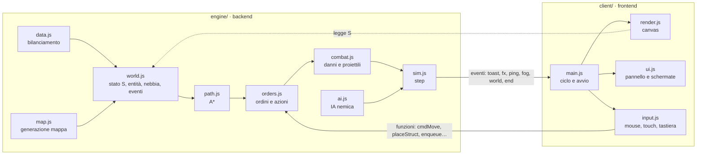

# Architettura

Il gioco è diviso in due parti che si parlano attraverso un contratto stretto.

## Motore (`engine/`)

Codice JavaScript puro (moduli ES), senza DOM: gira nel browser e in Node. Si importa solo da `engine/index.js`.

| File | Contenuto |
|---|---|
| `data.js` | costanti della mappa, telai, propulsioni, armi, edifici, ricerche, livelli di difficoltà |
| `util.js` | numeri casuali con seme, rumore per il terreno, angoli, riferimenti di settore (A1–H8) |
| `map.js` | mappa 64×64 simmetrica rispetto al centro, giacimenti, corridoi garantiti tra le basi |
| `world.js` | stato `S`, creazione di mezzi ed edifici, visibilità del giocatore, salvataggio, eventi |
| `path.js` | passabilità e percorsi A* a 8 direzioni, disposizione dei gruppi, mappe di raggiungibilità (`reachMap`, `reachableAdj`) |
| `orders.js` | ordini (muovi, attacca, costruisci, ferma), piazzamento, produzione, ricerca, smontaggio (`demolish`) |
| `combat.js` | distanze, scelta dei bersagli, danno con corazza, colpi, proiettili |
| `sim.js` | movimento, costruzione, produzione, torrette, officine, fine partita, `step(dt)` |
| `ai.js` | IA del Direttorio Ferreo: pompe, edifici, ricerca, produzione, difesa, ondate; sceglie solo posti raggiungibili e smonta i cantieri bloccati da più di `AI_STALL` secondi |

### Stato

`S` è un oggetto serializzabile in JSON: `seed`, `diff`, `time`, `ents` (mezzi ed edifici, con `id`), `res`
(gasolio per lato), `tech` (ricerche completate per lato), `designs` (progetti del giocatore), `ai`, `stats`,
`timers`, `phase` (`play`, `won`, `lost`). Terreno, giacimenti e occupazione si ricalcolano dal seme.
`S.ai.skip` elenca i giacimenti che l'IA ha scartato perché irraggiungibili; i campi numerici `aiA`…`aiT` sugli
edifici incompiuti dell'IA servono a riconoscere i cantieri fermi. Il salvataggio (`serialize`) include anche i
proiettili in volo, che `loadState` rimette nell'array `proj`.

### Eventi verso il client

| Evento | Dati | Uso |
|---|---|---|
| `world` | — | nuova mappa: il client ridisegna il terreno |
| `fog` | — | visibilità aggiornata (ogni 0,2 s) |
| `fx` | `{k, …}` con `k` tra `boom`, `scorch`, `flash`, `tracer`, `hit`, `trail`, `spark`, `spray`, `chimney`; `flash` porta `w` (arma: `MG`, `CN`, `RK`, `MO`) e `owner` (chi spara); `boom` porta `kind` (`unit`, `struct`: `owner` è il lato distrutto; `shot`: `owner` è il tiratore) | effetti visivi e suoni |
| `unit` | `{owner, id, x, y}` | un mezzo (anche un geniere) esce da fabbrica o comando |
| `built` | `{owner, id, type}` | un cantiere è finito (non per il comando iniziale) |
| `placed` | `{owner, id, type}` | un cantiere è stato piazzato |
| `research` | `{owner, id}` | una ricerca è completata |
| `toast` | `{text, kind}` | avviso al giocatore (`kind`: vuoto, `warn`, `bad`) |
| `ping` | `{x, y}` | segnale sulla minimappa |
| `end` | `{won}` | fine partita |

## Client (`client/`)

| File | Contenuto |
|---|---|
| `index.html` | struttura della pagina (barra, mappa, pannello, copertina) |
| `style.css` | stile e token di colore |
| `state.js` | stato del solo client: selezione, camera, scheda attiva, effetti |
| `render.js` | terreno, edifici, mezzi, effetti, nebbia, minimappa |
| `input.js` | selezione, ordini, scorciatoie, touch e zoom |
| `ui.js` | pannello (Costruisci, Produzione, Ricerca, Progetta), avvisi, copertina, rapporto finale |
| `main.js` | collega eventi e moduli, ciclo di gioco, aggancio di test `window.__wz` |

## Build

`npm run build` (esbuild) produce un solo file con CSS e JavaScript in linea:

- `dist/index.html`: documento completo, per browser e per l'app Android;
- `dist/artifact.html`: frammento per l'anteprima pubblicata su claude.ai.

## Android

`android/` è un guscio nativo minimo: una `MainActivity` con una WebView a schermo intero e in orizzontale che carica
`file:///android_asset/index.html`. Nessun permesso, nessuna libreria AndroidX. `scripts/android-sdk.sh` installa
l'SDK in `~/android-sdk` (piattaforma e build-tools 35); `npm run android` fa la build web, copia `dist/index.html`
negli asset (file generato, ignorato da git), lancia `./gradlew assembleDebug` e copia l'APK in
`dist/warzone1989.apk`, firmato con la chiave di debug della macchina di build.

## Test

- `npm test`: test del motore in Node (`engine/test/`).
- `npm run e2e`: build, poi prova nel browser su computer, telefono verticale e telefono orizzontale
  (`tests/e2e/smoke.mjs`), con screenshot in `tests/e2e/out/`. `E2E_PROFILE=<nome>` prova un solo profilo.
- `node tests/android/verify-apk.mjs`: dopo `npm run android`, controlla pacchetto, versioni SDK, permessi,
  orientamento, firma e che l'asset dell'APK sia identico a `dist/index.html`.
